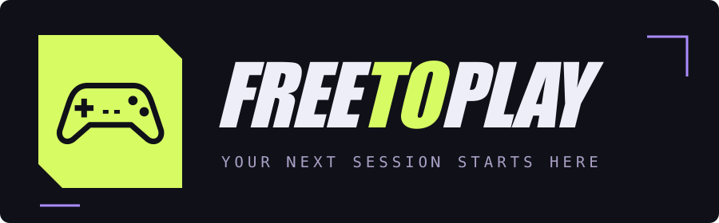
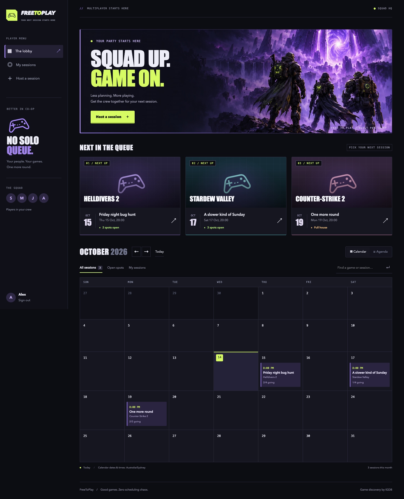
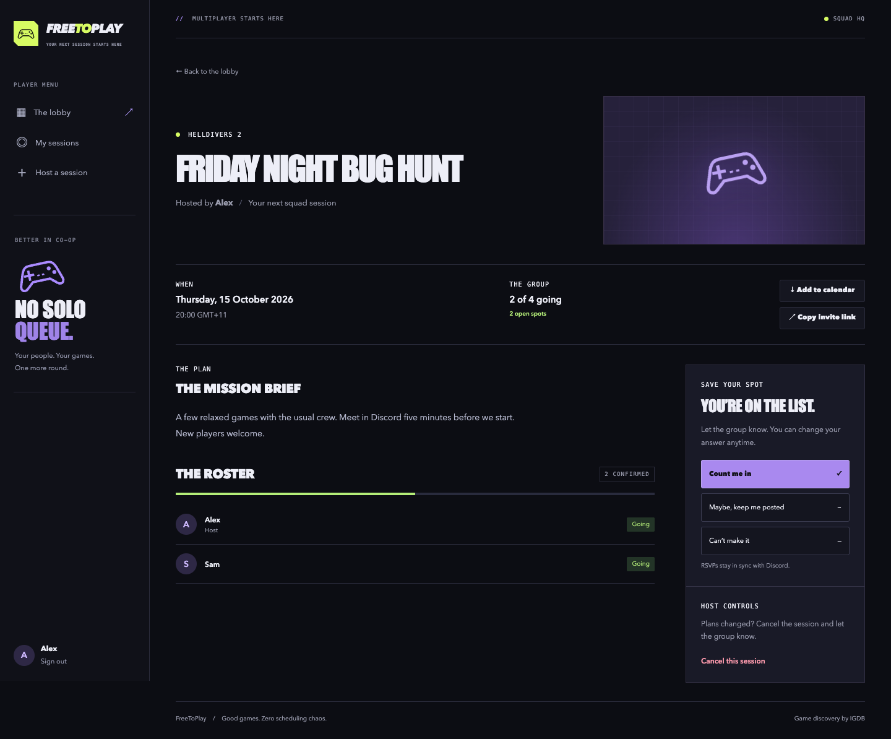
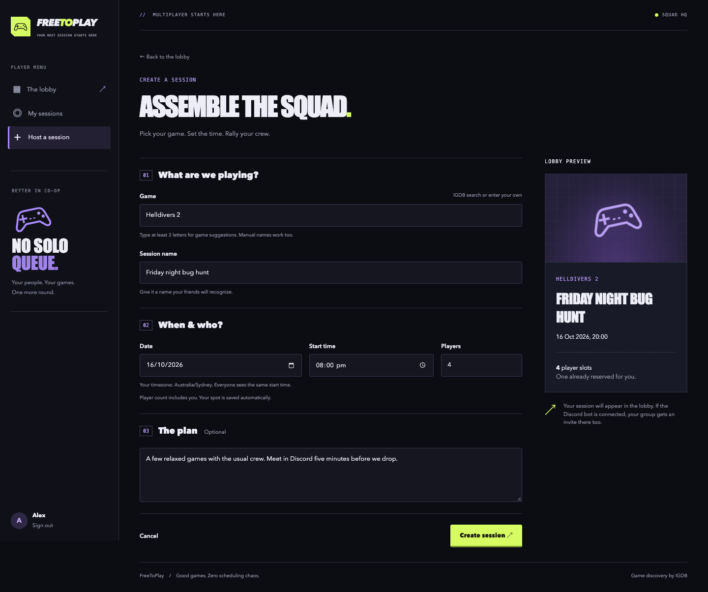
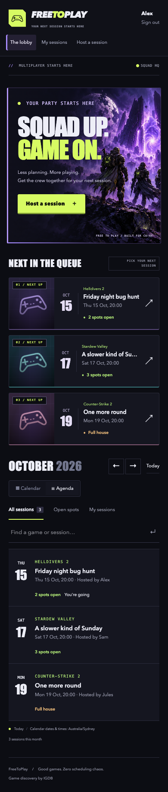
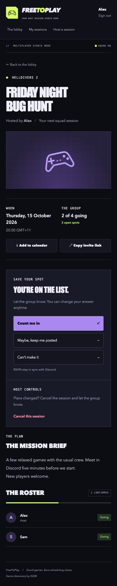

<p align="center">
  
</p>

<p align="center">
  <strong>Squad up. Game on. Your gaming lobby + Discord bot.</strong>
</p>

<p align="center">
  <a href="https://github.com/mckenna654/FreeToPlay/releases"></a>
  <a href="LICENSE"></a>
  
  
</p>

---

## About

**FreeToPlay** is a self-hosted web app and Discord bot for adult gaming groups who struggle to line up schedules.

Log in with Discord, pick a game, set a time, and let friends RSVP from the web calendar **or** straight from Discord. When someone creates or cancels a session, the bot keeps your channel in sync automatically.

Ideal for Unraid, Docker, Portainer, or any home server — with optional HTTPS via Nginx Proxy Manager.

---

## Features

### Web dashboard
- **Gaming lobby UI** — midnight backgrounds, violet and lime accents, bold game-menu typography, and original sci-fi artwork
- **Calendar and agenda** — monthly planning on desktop; readable agenda by default on phones
- **Find your next session** — search titles, games, or hosts; filter by open spots or your RSVPs
- **Upcoming session tickets** — game artwork, dates, and remaining spots at a glance
- **Event detail pages** — game artwork, host, notes, and a clear roster
- **RSVP statuses** — Going, Maybe, and Can’t make it, synchronized with Discord
- **Calendar downloads and sharing** — download an individual session as an .ics file or copy its invite link
- **Guided scheduling** — live preview, keyboard-accessible game search, and validation that preserves your input
- **Timezone-aware creation** — browser-local start times are stored as a precise instant; event details display your local time
- **Capacity tracking** — max players + live progress bar (e.g. 3/4 filled)
- **Host controls** — creators can cancel/delete their own events
- **Discord login** — Passport OAuth2, no separate accounts

### Game search & art
- **IGDB API autocomplete** — type a game name, pick from live results (powered by Twitch)
- **Cover art** — pulled automatically onto the dashboard and Discord embeds
- Works without an API key (manual game names still work)

### Discord bot
- **Rich embeds** on new sessions (title, game, time, slots, host, cover art)
- **Interactive buttons** — Join / Tentative / Decline (syncs to the database)
- **Web Dashboard button** — opens your calendar so others can host too
- **Clickable event title** — links to that session’s web page
- **Cancellation sync** — deletes the original embed and posts a cancel notice

### Deploy & ops
- **Docker / GHCR image** — `ghcr.io/mckenna654/freetoplay:latest`
- **SQLite + Prisma** — simple single-file DB on a volume
- **Reverse proxy ready** — trust proxy + secure cookies for HTTPS domains
- **MIT licensed**

---

## Screenshots

The v1.7.0 gaming lobby: dark surfaces, violet/lime accents, bold type, and original sci-fi artwork. Screenshots use sample sessions and players; controller tiles show the fallback when a session has no IGDB artwork.

### Desktop lobby



<details>
<summary>Session details and scheduling</summary>





</details>

### Mobile

<p>
  
  
</p>

---

## Quick start (Docker / Unraid)

**Image:** `ghcr.io/mckenna654/freetoplay:latest`

| Setting | Value |
|--------|--------|
| Network | Bridge |
| Port | `3000` → `3000` |
| Path | Host `/mnt/user/appdata/freetoplay/data/` → Container `/app/data` |

### Environment variables

| Variable | Required | Description |
|----------|----------|-------------|
| `DISCORD_CLIENT_ID` | Yes | Discord application client ID |
| `DISCORD_CLIENT_SECRET` | Yes | Discord application client secret |
| `DISCORD_BOT_TOKEN` | Yes | Bot token |
| `DISCORD_CHANNEL_ID` | Yes | Channel ID for session posts |
| `BASE_URL` | Yes | Public URL, e.g. `https://f2p.example.com` or `http://192.168.1.50:3000` |
| `SESSION_SECRET` | Yes | Random string for login cookies |
| `DATABASE_URL` | Yes | Must be `file:/app/data/prod.db` |
| `IGDB_CLIENT_ID` | No | Twitch/IGDB Client ID for game search/art |
| `IGDB_CLIENT_SECRET` | No | Twitch/IGDB Client Secret |
| `PORT` | No | Defaults to `3000` |

---

## Discord setup

1. Create an app in the [Discord Developer Portal](https://discord.com/developers/applications).
2. **OAuth2 → Redirects:** add  
   `{BASE_URL}/auth/discord/callback`  
   Example: `https://f2p.example.com/auth/discord/callback`
3. Create a **Bot**, copy the token, enable message/embed permissions.
4. Invite the bot with the `bot` scope (Send Messages, Embed Links, View Channels).
5. Enable **Developer Mode** in Discord → right-click your channel → **Copy Channel ID**.

---

## IGDB game database (optional)

FreeToPlay uses Twitch's IGDB to power game search and cover art.
1. Sign up at [dev.twitch.tv](https://dev.twitch.tv/console) and register an application.
2. Generate a Client Secret.
3. Set `IGDB_CLIENT_ID` and `IGDB_CLIENT_SECRET` as environment variables on your container.
4. Restart the container. On **Host a session**, type 3+ letters in **Game** for autocomplete + cover art.

---

## External hosting (Nginx Proxy Manager)

1. Set `BASE_URL` to your HTTPS domain, e.g. `https://f2p.example.com`.
2. Add the same domain callback in Discord OAuth2 redirects.
3. In NPM, add a Proxy Host:
   - **Domain:** `f2p.example.com`
   - **Forward to:** your server IP, port `3000`
   - **SSL:** Let’s Encrypt + Force SSL
   - Enable Websockets if available

---

## Local development

Use Node.js 24 or newer (`nvm use` selects Node 24). The Docker image also uses Node 24 to support the current SQLite and Prisma dependencies.

```bash
git clone https://github.com/mckenna654/FreeToPlay.git
cd FreeToPlay
cp .env.example .env   # fill in Discord + secrets
npm install
npx prisma migrate dev
npm run dev
```

Open `http://localhost:3000`.

Calendar month boundaries use the server timezone, shown below the schedule. Set the server/container `TZ` environment variable to your group's timezone (for example, `Australia/Sydney`) if needed. Upcoming ticket dates and session details are displayed in the viewer's local timezone when JavaScript is enabled. Without JavaScript, the form uses the labeled server timezone.

Run `npm test` to build and check the app against an isolated temporary SQLite database. Tests cover page rendering, search/filter state, session validation and creation, RSVP/cancellation permissions, and calendar exports. They do not load your `.env` or connect to Discord.

For a local preview with sample sessions, run `node tests/support.cjs` after building and open the printed localhost URL. This fixture uses a separate temporary database; Discord login is intentionally disabled.

---

## Stack

- **Node.js** + **Express** + **EJS**
- **Prisma** + **SQLite**
- **discord.js**
- **Passport Discord OAuth**
- **Tailwind CSS**
- **Docker** (multi-stage Debian Bookworm image)

---

## Changelog

See [CHANGELOG.md](CHANGELOG.md) for the full **1.x** release history.

| Version | Highlights |
|---------|------------|
| **1.7.0** | Gaming lobby redesign, new branding, agenda/search/filters, calendar downloads, and timezone-aware scheduling |
| **1.6.0** | Migrated game search and artwork integration to IGDB |
| **1.5.1** | Docker build fix + migration recovery guidance |
| **1.5.0** | Branding, MIT license, docs polish |
| **1.4.0** | Discord web links, reverse proxy / HTTPS support |
| **1.3.0** | Host cancel + Discord cancellation sync |
| **1.2.0** | Calendar UI, RSVP statuses, interactive Discord buttons |
| **1.1.0** | Game search + cover art |
| **1.0.0** | Initial web app, Discord bot, Docker |

> **Note:** Pull `ghcr.io/mckenna654/freetoplay:latest` or pin `:v1.7.0`.
> Do not pin old tags like `v1.0.0`–`v1.4.0` for production — those point at early snapshots.

---

## License

[MIT](LICENSE) © mckenna654
