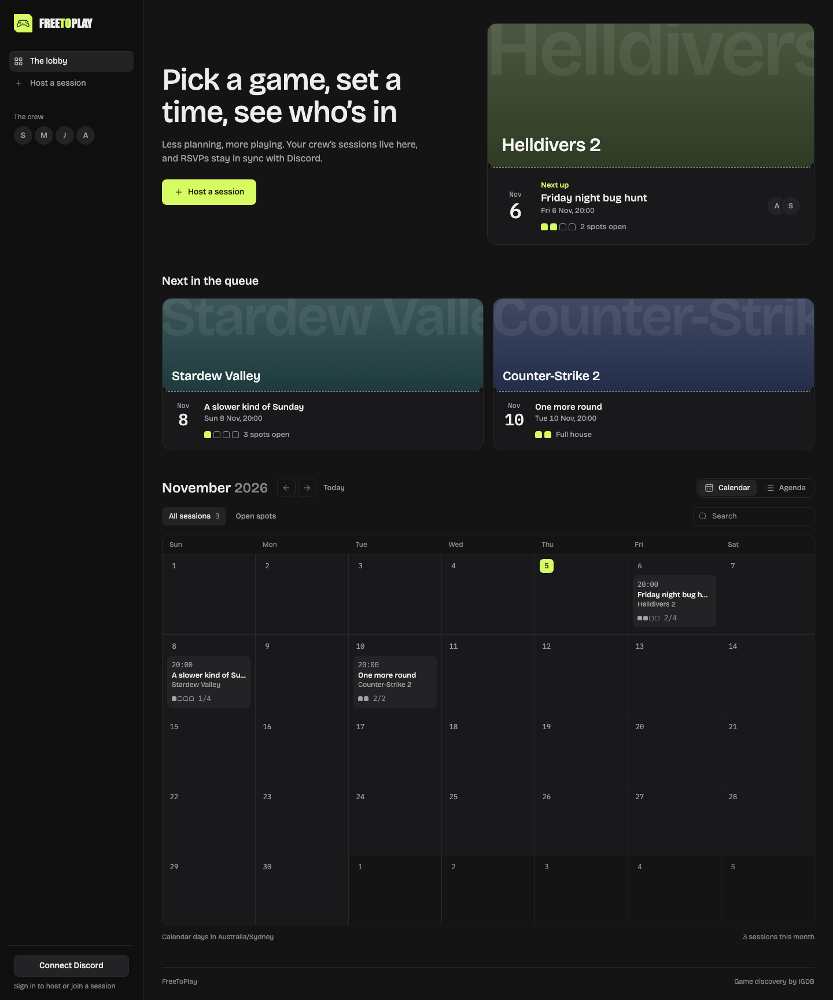

# Pick a game, set a time, see who's in

FreeToPlay now puts your next session first. This release redesigns every screen around quiet dark surfaces, with the colour saved for your games.

## What's new

- The lobby opens with your real next session as a ticket, showing the game, the time and who's in.
- Seat markers show filled and open player slots on tickets, the calendar, the agenda and session pages.
- Games without a cover get their name set large in a colour that stays the same for that game.
- Times use one format across the app, and calendar entries show your local time.
- Text is larger and easier to read, with fonts bundled in the app, so there are no outside font requests.

## Upgrade

Pull `ghcr.io/mckenna654/freetoplay:latest`, or pin `:v1.8.0`. No configuration or database changes are needed. To go back, pin `:v1.7.0`.
